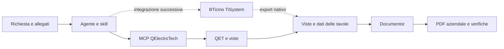

# Gridline · Grid Society

**Descrivi il circuito al tuo agente. Gridline gli fornisce metodo, strumenti e
standard per produrre un unifilare modificabile e il PDF aziendale.**

> «Leggi AGENTS.md e usa la skill grid-single-line. Parti dallo schema allegato,
> conserva l'esistente e inserisci un doppio montante cliente/BESS. Genera il
> QET editabile e il PDF Documentor; registra ipotesi e verifiche aperte.»

L'agente interpreta la richiesta, sceglie i simboli e modifica il circuito.
QElectroTech conserva il disegno elettrico; Documentor produce il PDF finale.
Gridline offre gli strumenti di supporto, senza sostituire il riesame elettrico.

## Per iniziare con un agente

Scarica questo repository o clonalo:

```sh
git clone https://github.com/gridsociety/gridline.git
cd gridline
```

Apri questa cartella nell'agente che usi e incolla:

> Leggi AGENTS.md e docs/installation.md. Verifica i requisiti con
> scripts/doctor.py. Riusa le installazioni funzionanti, indica esattamente
> cosa manca e configura il server MCP senza sovrascrivere gli altri server.
> Installa le dipendenze fissate, esegui la prova completa in una nuova cartella,
> controlla PDF e QET. Poi lavoriamo sulla mia commessa fuori dal repository.

La diagnosi preliminare funziona anche prima di installare le librerie:

```sh
python3 scripts/doctor.py --json
```

Per l'ambiente Python, con [uv](https://docs.astral.sh/uv/getting-started/installation/):

```sh
uv sync --frozen
uv run --frozen gridline doctor
uv run --frozen gridline smoke workspaces/first-run
```

**Documentor è una dipendenza aziendale privata.** Il repository Gridline è
pubblico, ma per installare Documentor serve l'accesso del collega al repository
`gridsociety/documentor`. Non occorre un account personale dell'autore.
Per il render locale non serve accedere al registro di pubblicazione.
La [guida di installazione](docs/installation.md) fissa la revisione e spiega
come installare Chromium e individuare i requisiti mancanti. QElectroTech è
un'applicazione separata e va installata sul computer.

## Cosa contiene

| Percorso | Responsabilità |
| --- | --- |
| `skills/gridline/` | Orientamento dell'agente e scelta dell'integrazione |
| `skills/grid-single-line/` | Metodo elettrico e grafico QElectroTech |
| `src/qelectrotech_mcp/` | Server MCP STDIO: simboli, fogli, apparecchi, collegamenti, BOM e validazione |
| `src/gridline/` | CLI, diagnosi, workspace, demo MCP e composizione Documentor |
| `src/gridline/resources/` | Catalogo con provenienza, logo e template per le tavole |
| `integrations/qelectrotech/` | Procedura e limiti dell'integrazione disponibile |
| `integrations/bticino/` | Punto di ingresso per il secondo contributo, attualmente pianificato |
| `examples/double-feeder/` | Richiesta e istruzioni per la demo sintetica |
| `tests/` | Regressioni del codice e del contratto di progetto |



## Comandi

```sh
uv run --frozen gridline integrations
uv run --frozen gridline new /percorso/commessa --backend qelectrotech
uv run --frozen gridline mcp-config /percorso/commessa --format toml
uv run --frozen gridline check /percorso/commessa
uv run --frozen gridline render /percorso/commessa
uv run --frozen gridline demo workspaces/demo --no-render
```

`new` crea un progetto vuoto, non un circuito progettato. `demo` costruisce
attraverso MCP un esempio fittizio a due partenze; senza `--no-render` produce
anche il PDF. `smoke` aggiunge il requisito dell'applicazione QET e della sua
libreria presenti. Le destinazioni devono essere nuove: non sovrascrive prove
o progetti esistenti. `render` richiede viste SVG/PDF e `drawing-set.json` coerenti
con il QET; non importa automaticamente modifiche manuali dal disegno.

Ogni commessa conserva `source/`, `inputs/`, `notes/`, `variables/`, `qa/`,
`out/` e `published/`. Generazione e pubblicazione sono passaggi distinti.

## Stato e contributi

Prima versione: flusso QElectroTech derivato dallo standard aziendale 1.0.1,
con diagnosi portabile, dipendenze fissate e prova MCP riproducibile.
L'integrazione BTicino non è dichiarata disponibile finché non arriva il suo
contributo verificato. Il rilevamento include macOS, Windows e Linux;
le verifiche effettivamente eseguite sono riportate in [VALIDATION.md](VALIDATION.md).

- [Installazione e requisiti](docs/installation.md)
- [Uso da un agente](docs/agent-workflow.md)
- [Architettura e contratto delle integrazioni](docs/architecture.md)
- [Istruzioni per il contributo BTicino](docs/BTICINO-HANDOFF.md)
- [Contribuire e convenzioni dei commit](CONTRIBUTING.md)
- [Provenienza e licenze dei contenuti](NOTICE.md)

XML valido, PDF leggibile, resa nativa QET e validazione elettrica sono controlli
separati. Le verifiche automatiche non attestano dimensionamento, selettività,
tarature o conformità normativa.
