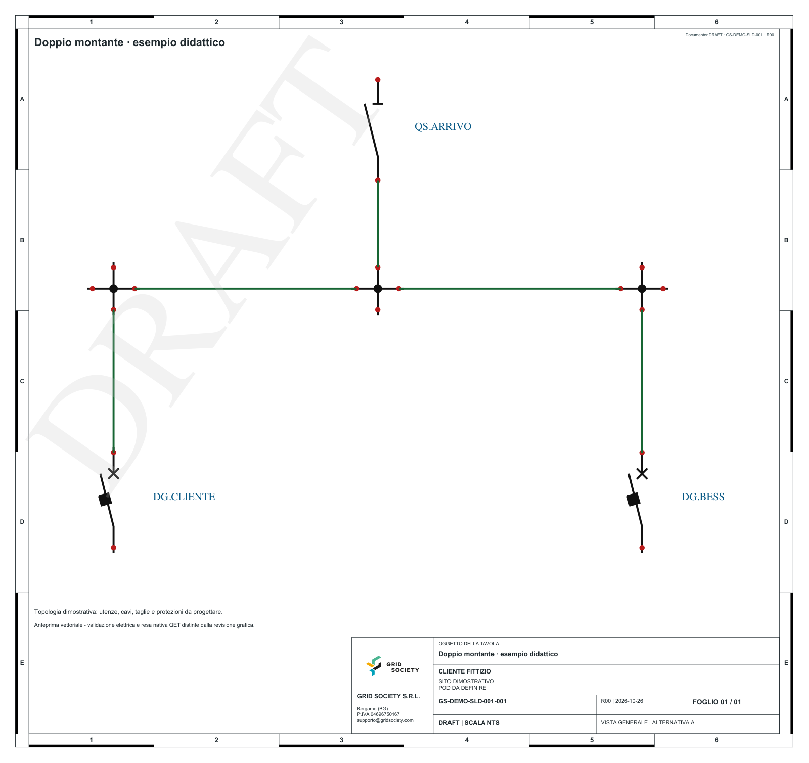

# Doppio montante sintetico

Richiesta: «Da un arrivo comune crea due partenze indipendenti, cliente e BESS.
Mostra il principio topologico senza attribuire taglie, tarature o dati reali».

```sh
uv run --frozen gridline demo workspaces/double-feeder
```

La demo chiama un vero server MCP STDIO, incorpora i simboli distribuiti e
produce QET, SVG, CSV, PDF Documentor, anteprima e QA. Serve a verificare gli
strumenti e a mostrare il flusso; non progetta protezioni né circuiti di misura.
I terminali di uscita sono intenzionalmente aperti verso utenze da progettare.

Per verificare solo generazione QET/MCP senza Documentor:

```sh
uv run --frozen gridline demo workspaces/qet-only --no-render
```

Gli output vengono generati fuori dai sorgenti e sono ignorati da Git. Nessun
dato o allegato di commessa è necessario per ripetere la prova.

## Risultato della prima verifica

[PDF DRAFT](sample/double-feeder_DRAFT.pdf) · [QET editabile](sample/double-feeder.qet) · [verifiche e hash](sample/validation.json)


